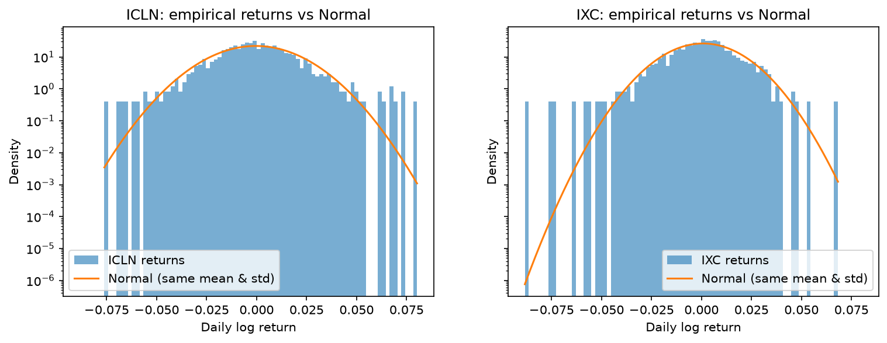
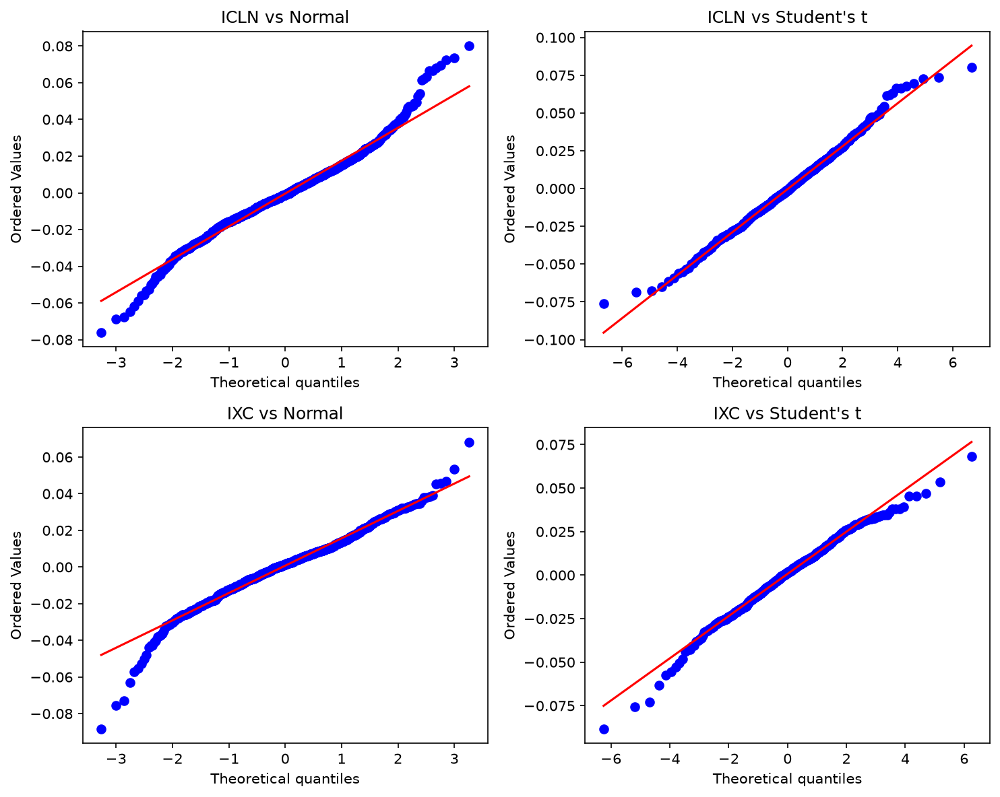
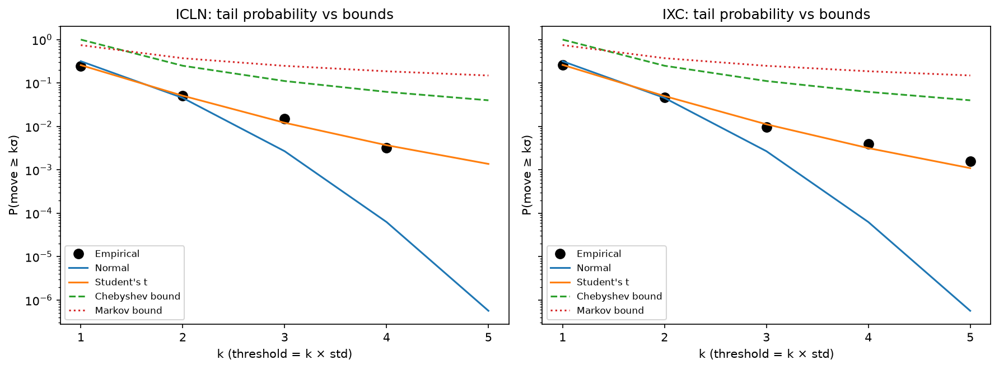
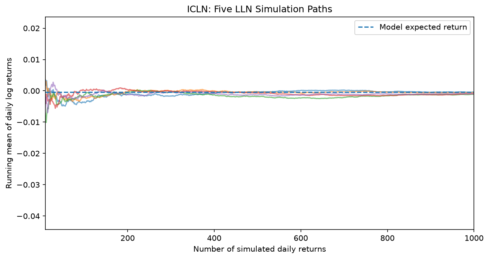
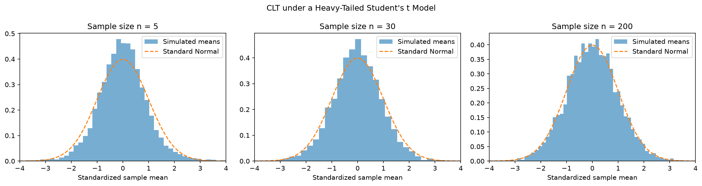

# Tail Risk in Clean vs Traditional Energy Equities

**DS603 Probability for Data Science, Group Project (AY2026/27 August Term)**
This repository is MDSE group work submitted for DS603. It serves as the project report.

**Members:** Amsyar, Liang-Yu  ·  See [CONTRIBUTIONS.md](CONTRIBUTIONS.md) and [AI_USAGE.md](AI_USAGE.md)

## Research question
Do clean-energy (ICLN) and traditional-energy (IXC) daily equity returns differ in tail risk, and how conservative are Markov and Chebyshev bounds and how fast does the sample mean converge relative to Normal and Student’s t models for each?

## Motivation
Investors moving capital from oil and gas into renewables need to know whether they are also taking on different extreme-day risk. Clean-energy stocks are sensitive to policy news and interest rates, while traditional energy is driven by oil-price shocks, so their tails may differ in size and direction. Comparing the two shows when Normal-based risk tools and distribution-free bounds can be trusted for each sector.

## Data
| Item | Detail |
|---|---|
| Series | Daily log returns from adjusted Close prices |
| Tickers | ICLN (iShares Global Clean Energy), IXC (iShares Global Energy) |
| Window | 4 Jan 2021 – 31 Dec 2025 (1,254 daily returns per ETF) |
| Source | Yahoo Finance via `yfinance` (public data) |

**Access:** `data/raw/raw_energy_prices.csv` is included. Downloaded from Yahoo Finance with yfinance (auto_adjust=True), 2021-01-01 to 2026-01-01.
**Licensing:** public data only; no SMU-licensed extracts are used.
**Cleaning notes:** Completely priced data (no missing values) is available for both ETFs during all 1,255 trading days. The daily log returns are calculated as r_t = ln(P_t / P_{t-1}) with the first day being dropped to give 1,254 returns per ETF. The ex-dividend days do not show as false price drops because the `Close` column already has been updated for dividends and splits, when the data was downloaded with auto_adjust=True.

## Repository map
```
data/raw/                              raw prices (yfinance export)
data/processed/                        log returns
notebooks/01_tails_and_bounds.ipynb    Stages 1–4: description, Normal vs t, Markov/Chebyshev
notebooks/02_monte_carlo_lln_clt.ipynb Monte Carlo LLN and CLT
outputs/figures/                       all figures
outputs/tables/                        tail-probability table
outputs/presentation/                  slide deck (PDF)
```


## How to run
1. `pip install -r requirements.txt` (Python 3.14)
2. Open the notebooks in order (01, then 02) and **Run All**. All paths are relative; seeds are fixed.

## Methods
1. **Normal vs Student's t (tail calibration).** Fitted Normal and Student's t distributions to each ETF's daily returns by maximum likelihood, compared them with AIC, and checked tail fit with QQ plots and a table of P(|r − μ| ≥ kσ) for k = 1 to 5 (empirical vs Normal vs t).
2. **Markov and Chebyshev bounds.** Applied Markov's inequality to the non-negative |r| and Chebyshev's inequality to |r − μ| at the same thresholds, and measured how many times larger each bound is than the observed frequency.
3. **Monte Carlo, LLN and CLT.** Simulated thousands of samples of daily returns (fixed seeds 67 and 69) to show the sample mean converging to the true mean as n grows (LLN), and the standardised sample mean approaching a Normal distribution under heavy-tailed Student's t returns (CLT).

## Key results
- **Both ETFs have fat tails.** ICLN had 19 days and IXC 12 days beyond 3σ, versus 3.4 expected under a Normal distribution (5.6× and 3.6× more). Excess kurtosis is 2.0 (ICLN) and 2.7 (IXC).

  

- **Student's t fits far better than the Normal.** The fitted t has ν ≈ 5.0 (ICLN) and 5.5 (IXC), and beats the Normal by ΔAIC ≈ 87 and 84. It matches the observed tail counts within a few days at 3σ and 4σ, where the Normal underestimates by 50–60×.

  

- **Markov and Chebyshev bounds always held but are very conservative.** Chebyshev overstated tail frequencies by 4–25×, and Markov by 3–190×. The overstatement grows further into the tail, because real return tails fall faster than the 1/k² and 1/k worst cases.

  

- **The sample mean converges as the LLN predicts.** In 3,000 simulations, the standard deviation of the sample mean fell from 0.0057 (n = 10) to 0.00058 (n = 1,000), matching σ/√n. The chance of missing the true mean by more than 0.2 percentage points fell from 74% to 0%.

  

- **Averages of fat-tailed returns become Normal (CLT).** With Student's t (ν = 3) returns, the standardised sample mean was still more peaked than a Normal at n = 5 (peak ≈ 0.5 vs 0.4), but at n = 30 it was closer but still slightly peaked, and by n = 200 it matched the standard Normal and by n = 200 it matched the standard Normal. The CLT holds because the variance is finite when ν > 2. Daily returns are not Normal, but averages over a month or more are, so Normal-based tools suit average returns, not single extreme days.

  


- **Clean vs traditional.** ICLN is more volatile day to day (std 1.81% vs 1.51%), but IXC's risk is concentrated in rarer, larger crashes: negative skew (−0.47), the largest single-day loss (−8.8%), and 2 days beyond 5σ versus none for ICLN.

**Takeaway for a decision-maker:** A model which is based on normal distribution is completely inadequate at predicting extreme days for energy equities, and bounds based on distribution-free statistics overestimate them by a factor of 10 or more; the middle ground is a model based on the Student's t distribution, though this fails to capture the crash asymmetry of traditional energy.

## Limitations
- **One sample period.** Other years may be different, as all results are for 2021–2025, covering the post-2020 clean-energy boom and bust and the energy shock of 2022.
- **Independence assumption.** The tail table, the bounds and the Monte Carlo all treat daily returns as independent draws, but real returns show volatility clustering (calm and turbulent periods).
- **Symmetric model.** The Student's t is symmetric and fails to account for the negative skew of IXC, as the left tail of the QQ plot is more extended than the t's, whilst the right is less.
- **Very few extreme observations.** Beyond 4σ there are only 0–5 days per ETF, so ratios such as “2,800× the Normal” at 5σ rest on 1–2 days and are highly uncertain.
- **Simplified simulation.** The CLT experiment uses t with ν = 3 rather than the fitted ν ≈ 5, and the LLN experiment uses only ICLN.